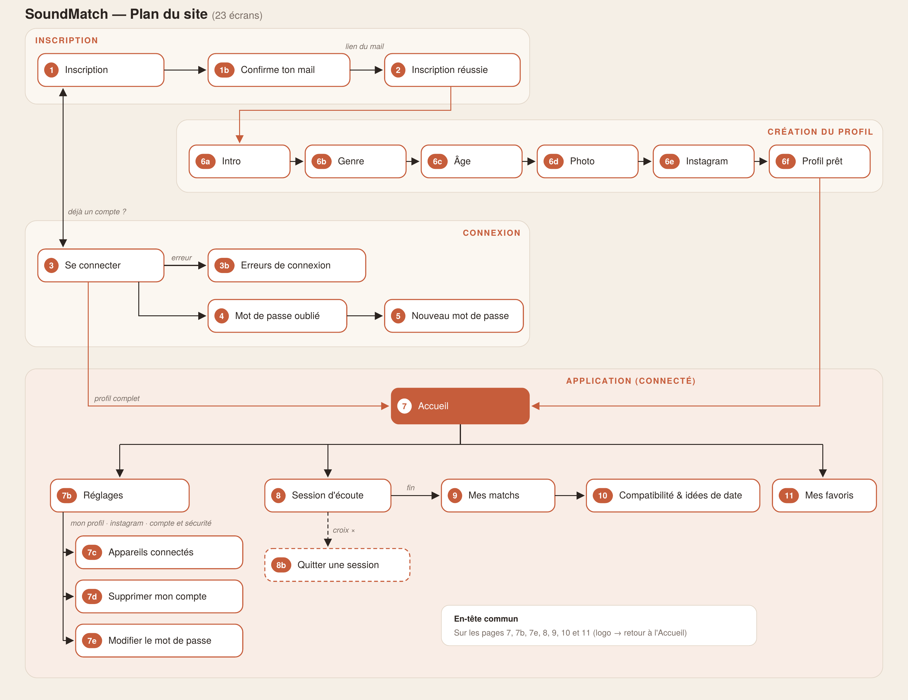

# SoundMatch — Cahier des charges

> Application web de rencontre basée sur les goûts musicaux.
> Ce document décrit chaque page de la maquette, ce que fait chaque bouton et les règles à respecter pour coder l'application.

## Sommaire

1. [Présentation du projet](#1-présentation-du-projet)
2. [Comment fonctionne le match](#2-comment-fonctionne-le-match)
3. [Glossaire](#3-glossaire)
4. [Charte graphique](#4-charte-graphique)
5. [Plan du site](#5-plan-du-site)
6. [Description détaillée des pages](#6-description-détaillée-des-pages)
7. [User stories](#7-user-stories)
8. [Données à enregistrer](#8-données-à-enregistrer)
9. [Point encore ouvert](#9-point-encore-ouvert)

---

## 1. Présentation du projet

**SoundMatch** est une application web de rencontre basée sur la musique. On ne choisit pas les gens sur leur photo : on découvre des personnes qui ont les mêmes goûts musicaux que soi. La rencontre peut être **amicale ou amoureuse**, et on peut tomber aussi bien sur un homme que sur une femme.

**Comment ça se passe :**

1. L'utilisateur lance une **session d'écoute de 20 extraits musicaux**. Chaque extrait dure **30 secondes**, mais il n'est **pas obligé de tout écouter** : dès qu'il sait s'il aime ou non, il clique sur « J'aime » ou « J'ignore » et passe directement à l'extrait suivant.
2. À la fin de la session, SoundMatch compare ses réponses avec celles des autres utilisateurs.
3. Il découvre ses **matchs**, classés du plus compatible au moins compatible, avec un pourcentage de compatibilité et des idées de date.
4. Pour se contacter, les utilisateurs **s'échangent leur Instagram**. L'Instagram n'est jamais public : chacun choisit, match par match, à qui il le partage.

| | |
|---|---|
| **Public visé** | Personnes de 18 ans et plus |
| **Support** | Application web utilisable sur **ordinateur et sur mobile**. |
| **Langues** | Français (par défaut) et anglais |

---

## 2. Comment fonctionne le match

**En gros :** deux personnes matchent quand elles ont **des goûts en commun sur les mêmes genres de musique**. Par exemple, si tu aimes surtout le rap et l'électro et que tu zappes le rock, tu seras très compatible avec quelqu'un qui aime aussi le rap et l'électro et qui n'aime pas le rock.

Les goûts communs comptent, mais aussi ce que vous n'aimez pas tous les deux : deux personnes qui détestent le rock ont aussi ça en commun.

Chaque session utilise une série de 20 extraits, définie à l'avance, etles matchs comparent deux profils indépendamment d'une session particulière.

**Plus tu fais de sessions, plus tes matchs sont précis :** tes réponses s'additionnent d'une session à l'autre, rien n'est effacé.

### Le calcul, étape par étape

1. Une session contient **20 extraits**, répartis en **4 genres de 5 extraits**.
2. Pour chaque genre, on calcule le **taux d'appréciation** de chaque personne, sur **tous** les extraits qu'elle a écoutés dans ce genre (toutes sessions confondues) :

```
   taux = nombre de J'aime dans ce genre ÷ nombre d'extraits écoutés dans ce genre
```

3. Pour chaque genre, on compare les deux personnes :

```
   score du genre = 100 − (écart entre les deux taux × 100)
```

4. La **compatibilité** est la moyenne des 4 scores, arrondie à l'unité.

### Exemple 1 : Toi et Léa → 80 % (très compatibles)

Après une première session (5 extraits écoutés par genre) :

| Genre | Toi | Léa | Score du genre |
|---|---|---|---|
| Pop | 4/5 aimés | 4/5 aimés | 100 % (mêmes goûts) |
| Rap | 5/5 | 4/5 | 80 % |
| Électro | 3/5 | 1/5 | 60 % |
| Rock | 0/5 | 1/5 | 80 % (vous n'aimez pas trop ça, ni l'un ni l'autre) |
| **Compatibilité** | | | **(100 + 80 + 60 + 80) ÷ 4 = 80 %** |

### Exemple 2 : Toi et Tom → 25 % (peu compatibles)

| Genre | Toi | Tom | Score du genre |
|---|---|---|---|
| Pop | 4/5 | 0/5 | 20 % |
| Rap | 5/5 | 1/5 | 20 % |
| Électro | 3/5 | 5/5 | 60 % |
| Rock | 0/5 | 5/5 | 0 % (goûts opposés) |
| **Compatibilité** | | | **25 %** |

### Exemple 3 : ce qui change après plusieurs sessions

Plus tard, de nouveaux extraits sont ajoutés. Tu as maintenant écouté 10 extraits d'électro et tu en as aimé 7 :

```
taux électro = 7 ÷ 10 = 0,7  (au lieu de 3 ÷ 5 = 0,6 après ta première session)
```

Ton profil devient plus précis, et ta compatibilité avec chaque personne est recalculée.

### Autres règles

- **Nouvelle session :** les réponses s'ajoutent à celles des sessions précédentes, rien n'est effacé. Les matchs sont ensuite recalculés avec toutes les réponses.
- **Extrait déjà écouté :** si l'utilisateur réécoute un extrait qu'il avait déjà évalué, sa nouvelle réponse remplace l'ancienne, pour cet extrait uniquement (les goûts peuvent changer).
- **Sons aimés en commun :** nombre d'extraits que les deux personnes ont aimés (selon leur réponse la plus récente).
- **Classement :** compatibilité décroissante. En cas d'égalité, le plus grand nombre de sons en commun passe en premier.
- **Qui apparaît dans mes matchs :** tous les utilisateurs qui ont terminé au moins une session, hommes et femmes confondus, sauf moi-même et les comptes supprimés.

## 3. Glossaire

| Terme | Définition |
|---|---|
| Extrait | Morceau de musique de 30 secondes, lu en boucle |
| Session (d'écoute) | Suite de 20 extraits que l'utilisateur évalue |
| J'aime / J'ignore | Les deux réponses possibles pour chaque extrait |
| Favori | Extrait gardé pour le retrouver plus tard |
| Match | Autre utilisateur comparé à soi, avec un pourcentage |
| Compatibilité | Pourcentage de ressemblance musicale entre deux personnes |
| Partage d'insta | Rendre son pseudo Instagram visible à un match précis |
| Échange complet | Les deux personnes se sont partagé leur Instagram |

---

## 4. Charte graphique

Style minimaliste, fond beige, accents terracotta.

| Rôle | Couleur |
|---|---|
| Fond de page | `#F4EFE7` (beige) |
| Fond des cartes | `#FFFCF7` |
| Bordures | `#E3DACC` |
| Texte principal | `#2B2521` |
| Texte secondaire | `#6B6159` |
| Couleur principale (boutons) | `#B85434` (terracotta), survol `#9C4429` |
| Erreurs | `#A63A22` sur fond `#FBEBE3` |
| Insta partagé / favoris / échange complet | vert `#4F7A45`, vert clair transparent `rgba(110,160,100,0.16)` |

- **Typographies :** Bricolage Grotesque (titres) et DM Sans (textes).
- **Boutons :** arrondis (forme de pilule), hauteur minimum 44 px.
  - Bouton principal : fond terracotta, texte blanc.
  - Bouton secondaire : contour beige foncé, fond transparent.
  - Un bouton désactivé est grisé.

---

## 5. Plan du site

La maquette compte **23 écrans**.



[Télécharger le plan du site en PDF](docs/maquettes/images/plan_du_site.pdf)

### En-tête commun

Présent sur les pages connectées (7, 7b, 7e, 8, 9, 10, 11).

| Élément | Action |
|---|---|
| Logo SoundMatch | Retour à la page 7 Accueil |
| « Le concept » | Section « Le concept » de l'Accueil |
| « Comment ça marche ? » | Section « Comment ça marche ? » de l'Accueil |
| « Mes matchs » | Page 9 |
| Icône signet + « Mes favoris » | Page 11 |
| Bouton « FR / EN » | Change la langue de toute l'interface |
| Icône roue | Page 7b Réglages |
| « Se déconnecter » | Ouvre la fenêtre de confirmation de déconnexion |

Le lien de la page en cours est surligné (fond beige foncé, texte terracotta).

### Fenêtre de confirmation de déconnexion

- Titre : « Es-tu sûr·e de vouloir te déconnecter ? »
- Texte : « Tu devras te reconnecter avec ton adresse mail ou ton pseudo pour revenir sur SoundMatch. »
- « Annuler » ferme la fenêtre.
- « Oui, me déconnecter » ferme la session sur cet appareil et renvoie vers la page 3.

---

## 6. Description détaillée des pages

### Page 1 — Inscription

**Objectif :** créer un compte.
**Accès :** page d'arrivée d'un visiteur non connecté. On y arrive aussi par « Créer un compte » (pages 3, 3b et 4), par « Modifier » (page 1b) et après la suppression d'un compte (7d).

**Contenu :** logo, sélecteur FR/EN, accroche « Rencontre quelqu'un qui vibre sur la même fréquence. », formulaire « Créer ton compte ».

**Toutes les données sont vérifiées** au clic sur « Créer mon compte », pas seulement la case à cocher.

| Élément | Règle | Message d'erreur |
|---|---|---|
| Nom d'utilisateur / pseudo | Obligatoire. 3 à 20 caractères : lettres, chiffres, `.` et `_` | « Choisis un pseudo. » / « 3 à 20 caractères : lettres, chiffres, point ou tiret bas. » |
| | Unique | « Ce pseudo est déjà utilisé. » |
| Adresse mail | Obligatoire, format valide | « Entre ton adresse mail. » / « Entre une adresse mail valide, par exemple toi@mail.com. » |
| | Unique | « Un compte existe déjà avec cette adresse. Connecte-toi. » |
| Mot de passe | Obligatoire. 4 règles : 10 caractères minimum, une majuscule, un chiffre, un caractère spécial | « Ton mot de passe ne respecte pas toutes les règles. » |
| Case « J'accepte les termes et conditions » | Obligatoire. Le lien ouvre les conditions dans un nouvel onglet | « Accepte les termes et conditions pour continuer. » |

**Fonctionnement :**

- Sous le mot de passe, les 4 règles s'affichent. Chacune passe de « · » gris à « ✓ » terracotta dès qu'elle est respectée.
- Au clic sur « Créer mon compte », chaque erreur s'affiche en rouge sous son champ, et le contour du champ devient rouge.
- Si tout est valide : le compte est créé (non confirmé), le mail de confirmation est envoyé et la page 1b s'ouvre.
- « Se connecter » ouvre la page 3.

### Page 1b — Confirme ton adresse mail

**Accès :** juste après la page 1.
**Contenu :** « Inscription · étape 2 sur 3 », titre « Confirme ton adresse mail », texte avec l'adresse saisie, 3 étapes (ouvre ta boîte mail → clique sur « Confirmer mon adresse » → tu reviens sur SoundMatch). À droite, un aperçu du mail (pour la démo de la maquette).

| Élément | Action |
|---|---|
| « Renvoyer le mail » | Désactivé pendant 2 minutes (« Disponible dans 1:59 »). Ensuite, il renvoie le mail, affiche « Mail renvoyé ✓ » et relance le compte à rebours |
| « Ce n'est pas la bonne adresse ? Modifier » | Retour à la page 1 |
| « Confirmer mon adresse » (dans le mail) | Active le compte et ouvre la page 2 |

**Règles :** le lien est valable 24 heures. Sans confirmation, on ne peut pas se connecter (voir page 3b).

### Page 2 — Inscription réussie

**Accès :** lien du mail de confirmation.
**Contenu :** « Bravo pour ton inscription ! Ton adresse mail est confirmée. Encore quelques questions et tu pourras commencer à matcher. »
**Bouton « Commencer → » :** page 6a (l'utilisateur est connecté).

### Page 3 — Se connecter

**Accès :** « Se connecter » (page 1), « Retour à la connexion » (pages 4 et 5), après une déconnexion.

| Élément | Type | Action |
|---|---|---|
| Adresse mail ou pseudo | Champ texte | Obligatoire. Accepte l'un ou l'autre |
| Mot de passe | Champ masqué | Obligatoire |
| « Mot de passe oublié ? » | Lien | Page 4 |
| « Se connecter » | Bouton principal | Vérifie les identifiants |
| « Créer un compte » | Lien | Page 1 |
| FR / EN | Sélecteur | Change la langue |

Mention : « Tu restes connecté·e 30 jours sur cet appareil. »

**Après le clic sur « Se connecter » :**

- Identifiants corrects et profil complet → page 7 Accueil.
- Identifiants corrects mais questions obligatoires pas terminées → page 6a.
- Sinon → message d'erreur (page 3b).

### Page 3b — Erreurs de connexion

**Objectif :** montrer tous les messages d'erreur de la connexion. C'est la page 3 avec les messages affichés au-dessus du formulaire, dans un encadré rouge clair.

| Cas | Message | Ce qui se passe |
|---|---|---|
| **Champ vide** | Sous le champ : « Entre ton adresse mail ou ton pseudo. » / « Entre ton mot de passe. » | Le champ vide passe en rouge |
| **Identifiants incorrects** | « Adresse mail, pseudo ou mot de passe incorrect. Vérifie ce que tu as écrit et réessaie. Il te reste X essais avant un blocage de 15 minutes. » | Les deux champs passent en rouge. Le message ne dit pas lequel des deux est faux, pour la sécurité |
| **Mail pas confirmé** | « Confirme d'abord ton adresse mail. On t'a envoyé un lien à l'inscription… » | Lien « Renvoyer le mail de confirmation ». Une fois cliqué, il affiche « Mail renvoyé ✓ » |
| **Trop de tentatives** (5 échecs) | « Trop de tentatives. Par sécurité, la connexion est bloquée pendant 15 minutes. » | Le bouton « Se connecter » est désactivé. Lien « Réinitialiser mon mot de passe » vers la page 4 |

### Page 4 — Mot de passe oublié

**Accès :** « Mot de passe oublié ? » (pages 3 et 3b) ou « Tu ne t'en souviens plus ? » (page 7e).

**État 1 — saisie de l'adresse :**

- « ← Retour à la connexion » ramène à la page 3. Si l'utilisateur est connecté (il vient de la page 7e), le lien devient « ← Retour aux réglages » et ramène à la page 7b, et le champ « Adresse mail » est déjà rempli.
- Champ « Adresse mail ».
- Bouton « Envoyer le lien ».

Messages :

- Format invalide : « Entre une adresse mail valide, par exemple toi@mail.com. »
- Aucun compte avec cette adresse : encadré rouge « Aucun compte n'est associé à cette adresse. Vérifie l'orthographe de ton adresse, ou crée ton compte en quelques secondes. », avec un lien « Créer un compte → ».
- Le message disparaît dès qu'on modifie l'adresse.

**État 2 — mail envoyé :**

- « On a envoyé un mail à [adresse]. Clique sur le lien pour définir un nouveau mot de passe. »
- « Renvoyer le mail » est désactivé 2 minutes, puis affiche « Mail renvoyé ✓ ».
- « Modifier l'adresse » ramène à l'état 1.
- Le lien du mail ouvre la page 5 et reste valable 1 heure.

### Page 5 — Nouveau mot de passe (mot de passe oublié)

**Accès :** uniquement par le lien du mail de la page 4. Comme l'utilisateur a oublié son mot de passe, on ne lui demande pas l'ancien.

| Élément | Règle / action |
|---|---|
| « Nouveau mot de passe » | Champ masqué + jauge de robustesse (Faible, Moyen, Bon, Robuste) + les 4 règles qui se cochent |
| « Écris encore une fois le mot de passe » | S'il est différent : « Les deux mots de passe ne sont pas identiques. » |
| « Confirmer » | Désactivé tant que les 4 règles ne sont pas respectées et que les deux champs ne sont pas identiques |

**Écran de succès :** « Mot de passe modifié. »
- Si l'utilisateur n'était pas connecté : « Tu peux te reconnecter avec ton nouveau mot de passe. », bouton « Retour à la connexion → » vers la page 3.
- Si l'utilisateur était connecté (il venait de la page 7e) : « Ton nouveau mot de passe est enregistré. », bouton « Retour à l'accueil → » vers la page 7.

**Règle :** tous les autres appareils sont déconnectés. Si l'utilisateur était connecté sur cet appareil, il le reste.

### Pages 6a à 6f — Questions obligatoires (premier lancement)

**Règles communes :**

- En haut : « Création du profil · toutes les questions sont obligatoires », l'étape (« 2 / 6 ») et une barre de progression.
- « Suivant → » reste désactivé tant que la réponse n'est pas valide. Une phrase à côté indique ce qu'il manque.
- « ← Retour » revient à l'étape précédente sans effacer les réponses.
- Pas d'accès à l'Accueil tant que les 4 questions ne sont pas remplies. Si l'utilisateur quitte, il reprend à la page 6a.

| Page | Contenu | Validation |
|---|---|---|
| **6a Intro** (1/6) | « Bienvenue sur SoundMatch ! », explication des 4 questions. Bouton « Créer mon profil → » | — |
| **6b Genre** (2/6) | « Tu es… » : Femme / Homme / Autre (un seul choix possible) | Une réponse. Sinon : « Choisis une réponse pour continuer » |
| **6c Âge** (3/6) | Champ « Date de naissance » au format jj.mm.aaaa | 18 ans ou plus. Messages : « Format attendu : jj.mm.aaaa » / « Désolé, SoundMatch est réservé aux 18 ans et plus. ». Si tout est bon : « 24 ans ✓ » |
| **6d Photo** (4/6) | « Ajouter une photo » ouvre la galerie de l'appareil. Ensuite le bouton devient « Changer la photo » | Une photo (JPG ou PNG, 5 Mo maximum). Sinon : « Ajoute une photo pour continuer » |
| **6e Instagram** (5/6) | Champ avec « @ » devant. Texte : « C'est toi qui choisis le partage… » | Au moins 2 caractères. Un « @ » tapé au début est retiré automatiquement |
| **6f Profil prêt** (6/6) | « Que l'aventure commence avec SoundMatch ». Bouton « Commencer → » vers la page 7 | — |

### Page 7 — Accueil

**Accès :** après la connexion, après la page 6f, ou par le logo.

| Section | Contenu | Éléments cliquables |
|---|---|---|
| Accroche | « Ta prochaine date commence par une chanson. » + texte | « Commencer à matcher → » ouvre la page 8. « Comment ça marche ? » descend à la section |
| Aperçu du lecteur | Illustration (« Ta session 0 / 20 », onde sonore, J'ignore / J'aime) | Rien : c'est une illustration |
| Le concept | 3 étapes : Écoute / Choisis / Match | — |
| Comment ça marche ? | Explication du score + exemple « Toi 86 % Léa » | — |
| Tes meilleurs matchs | Les 3 matchs les plus compatibles (initiale, prénom, âge, genres, %) | Chaque carte ouvre la page 10. « Voir tous mes matchs → » ouvre la page 9 |

**Si l'utilisateur n'a aucun match :** la section affiche seulement un petit message, « Tu n'as pas encore de match. Fais une session d'écoute pour découvrir les personnes qui ont les mêmes goûts que toi. », avec le bouton « Commencer à matcher → ». Le bouton « Voir tous mes matchs » est caché.

### Page 7b — Réglages

**Accès :** icône roue de l'en-tête.

**Haut de page :** « ← Retour à l'accueil », titre « Réglages », bouton « Enregistrer ». Après l'enregistrement : « Modifications enregistrées ✓ ».
**Menu latéral :** Mon profil · Instagram · Compte et sécurité · Supprimer mon compte (en rouge).

| Section | Élément | Règle / action |
|---|---|---|
| **Mon profil** | Photo | « Changer la photo » ouvre la galerie. **On ne peut pas retirer la photo**, car elle est obligatoire. Le texte l'explique sous le bouton |
| | Pseudo | Mêmes règles qu'à l'inscription |
| | Date de naissance | jj.mm.aaaa, 18 ans ou plus |
| | Je suis | Femme / Homme / Autre |
| **Instagram** | Mon nom d'utilisateur Instagram | Champ avec « @ » devant |
| | Liste « Partagé avec » | Personnes à qui l'insta est partagé. « Ne plus partager » retire le partage. Liste vide : « Tu n'as partagé ton insta avec personne. » |
| **Compte et sécurité** | Adresse mail | Si elle est modifiée, un mail de confirmation est envoyé à la nouvelle adresse. L'ancienne reste active tant que la nouvelle n'est pas confirmée |
| | Mot de passe | « Modifier le mot de passe » ouvre la page 7e |
| | Appareils connectés · 3 | « Gérer mes appareils » ouvre la page 7c |
| **Supprimer mon compte** | Avertissement | « Supprimer mon compte » ouvre la page 7d |

**Règle :** les champs du profil sont enregistrés au clic sur « Enregistrer ». Les erreurs utilisent les mêmes messages qu'à l'inscription et aux questions obligatoires.

### Page 7c — Mes appareils connectés

**Accès :** « Gérer mes appareils » (page 7b).

**Contenu :** « Choisis les appareils à déconnecter », compteur « Appareils connectés (3) », liste des appareils (nom · navigateur, ville · dernière activité). L'appareil utilisé porte l'étiquette « Cet appareil ».

| Élément | Action |
|---|---|
| « ← Retour aux réglages » / « Annuler » | Page 7b |
| Clic sur un appareil | Coche ou décoche l'appareil |
| « Tout sélectionner » / « Tout décocher » | Coche ou décoche tous les appareils |
| Bouton principal | Désactivé si rien n'est coché. Son texte change : « Déconnecter 1 appareil », « Déconnecter 2 appareils », « Déconnecter tous les appareils » |

**Règles :**

- Les appareils déconnectés disparaissent de la liste, avec un message vert (« iPhone et PC ont été déconnectés. »).
- Si « Cet appareil » est coché, un avertissement apparaît, puis l'utilisateur est renvoyé vers la page 3.
- S'il ne reste que cet appareil : « Tu n'es plus connecté·e que sur cet appareil. »

### Page 7d — Supprimer mon compte

**Accès :** « Supprimer mon compte » (page 7b).

**Contenu :** « Supprimer définitivement ton compte ? », « Cette action est irréversible. » Liste des données perdues : profil, photo et pseudo ; matchs et scores ; favoris et historique des sessions ; partages d'Instagram.

| Élément | Action |
|---|---|
| Case « Je comprends que toutes mes données seront supprimées définitivement. » | Obligatoire |
| Champ « Entre ton mot de passe pour confirmer » | Obligatoire. Mot de passe faux : « Mot de passe incorrect. » |
| « Annuler, garder mon compte » / « ← Retour aux réglages » | Page 7b |
| « Supprimer définitivement » | Désactivé tant que la case n'est pas cochée et le mot de passe pas rempli. Supprime le compte, déconnecte tous les appareils et affiche l'écran de fin |

**Écran de fin :** « Ton compte a été supprimé ». Le bouton « Retour à l'accueil » mène à la page 1 (l'accueil des visiteurs).
**Règle :** les autres utilisateurs ne voient plus ce profil.

### Page 7e — Modifier le mot de passe

**Accès :** « Modifier le mot de passe » dans les Réglages (page 7b). L'utilisateur est connecté, l'en-tête commun est affiché.

| Élément | Règle / action |
|---|---|
| « ← Retour aux réglages » / « Annuler » | Page 7b |
| **1. Mot de passe actuel** | Obligatoire. S'il est faux : « Mot de passe actuel incorrect. » (le champ passe en rouge) |
| Lien « Tu ne t'en souviens plus ? » | Page 4 Mot de passe oublié |
| **2. Nouveau mot de passe** | Jauge de robustesse + 5 règles qui se cochent : 10 caractères minimum, une majuscule, un chiffre, un caractère spécial, différent du mot de passe actuel |
| **3. Écris encore une fois le nouveau mot de passe** | S'il est différent : « Les deux mots de passe ne sont pas identiques. » |
| « Enregistrer le mot de passe » | Désactivé tant que les 3 champs ne sont pas remplis correctement. Au clic : vérifie l'ancien mot de passe, puis enregistre le nouveau |

**Écran de succès :** « Mot de passe modifié. Ton nouveau mot de passe est enregistré. Par sécurité, tes autres appareils ont été déconnectés ; tu restes connecté·e sur celui-ci. », bouton « Retour aux réglages ».

### Page 8 — Session d'écoute

**Accès :** « Commencer à matcher → » (page 7), « Nouvelle session → » (page 9), « Lancer une session → » (page 11).

**Haut :** « Ta session », « Extrait 8 / 20 », compteurs « ✓ 5 aimés » et « ✕ 2 ignorés », une **croix ✕** pour quitter la session (page 8b), puis une barre de 20 segments. Couleurs des segments : terracotta = aimé, beige foncé = ignoré, noir = extrait en cours, gris clair = à venir.

**Carte de l'extrait :**

| Élément | Action |
|---|---|
| Pochette, titre, artiste · genre | Informations sur l'extrait |
| Icône signet | Ajoute ou retire des favoris (vert plein = favori) |
| Onde sonore + « 0:11 » / « 0:30 · en boucle » | Se colore pendant la lecture. À 30 secondes, l'extrait recommence |
| « −5 » / « +5 » | Recule ou avance de 5 secondes |
| Lecture / Pause | Lance ou met en pause |
| Flèche circulaire | Recommence l'extrait à 0:00 |
| « ✕ J'ignore » | Enregistre « ignoré » et passe directement à l'extrait suivant |
| « ✓ J'aime » | Enregistre « aimé » et passe directement à l'extrait suivant |
| « Revenir au son précédent » | Annule le dernier choix. Désactivé sur le premier extrait |

**Règles :**

- L'extrait dure 30 secondes, mais **on n'est pas obligé de l'écouter en entier** : on peut répondre J'aime ou J'ignore à tout moment.
- La lecture démarre automatiquement à chaque nouvel extrait.
- Après le 20e choix : « Session terminée ! Tu as aimé X sons sur 20. » Deux boutons : « ← Revenir en arrière » et « Voir mes matchs → » (page 9).

### Page 8b — Quitter une session

**Accès :** croix ✕ en haut à droite de la page 8, pendant une session.

**Contenu :** la musique se met en pause et une fenêtre s'ouvre par-dessus la session, avec le titre « Tu veux quitter ta session ? ».

| Élément | Action |
|---|---|
| **Croix ✕** (en haut à droite de la fenêtre) | Ferme la fenêtre et revient au jeu : la musique reprend là où elle s'était arrêtée. |
| « Quitter la session définitivement » | Abandonne la session en cours, supprime les réactions associées et ramène à la page 7 Accueil. Une nouvelle session recommencera au premier extrait. |

**Règle :** Si l'utilisateur quitte ou ferme l'application avant d'avoir terminé les 20 extraits, la session est abandonnée et ses réactions ne sont pas conservées. Il n'est pas possible d'enregistrer une session pour la reprendre plus tard.

### Page 9 — Mes matchs

**Accès :** menu « Mes matchs », fin de session, « Voir tous mes matchs → ».

**Haut :** « Les profils qui te correspondent le mieux », bouton « Nouvelle session → » (page 8).

**Filtres** (un seul actif à la fois, en noir) : « Tous (6) » · « Ils m'ont partagé leur insta (3) » · « Insta échangé (1) ». Les nombres se mettent à jour automatiquement.

**Légende :** vert clair = insta partagé · blanc = pas encore partagé · badge vert foncé « Échange complet ✓ » = vous pouvez vous écrire.

**Carte d'un match** (triées par compatibilité) :

| Élément | Contenu / action |
|---|---|
| Photo, prénom, âge · ville | — |
| Pourcentage + jauge | Compatibilité |
| Étiquettes | Genres préférés de la personne |
| « 12 sons aimés en commun » | Extraits aimés par les deux |
| Badge Instagram | « Aucun partage » (gris), « T'a partagé son insta » (vert clair), « En attente de sa réponse » (terracotta clair), « Échange complet ✓ » (vert foncé) |
| Ligne « [Prénom] → toi » | Son pseudo (« @lea.vinyl ↗ »), qui ouvre son Instagram dans un nouvel onglet, ou « Pas encore partagé » |
| Ligne « Toi → [Prénom] » | « + Partager le mien » partage l'insta, le bouton devient « Partagé ✓ » (vert). Un nouveau clic retire le partage |
| « Compatibilité et idées de date → » | Page 10 de cette personne |

### Page 10 — Compatibilité & idées de date

**Accès :** bouton d'une carte (page 9) ou carte « Tes meilleurs matchs » (page 7).

| Bloc | Contenu / action |
|---|---|
| Retour | « ← Retour à mes matchs » vers la page 9 |
| Profil | Photo, « Léa, 24 », ville · sons en commun, « 86 % de compatibilité musicale » |
| Instagram | Mêmes états et mêmes couleurs vertes que sur la page 9. « Léa → toi » : pseudo + « Ouvrir Instagram ↗ », ou « Léa ne t'a pas encore partagé son insta ». « Toi → Léa » : « Léa peut voir ton insta » / « Ton insta reste privé » + bouton « + Partager mon insta » / « Partagé ✓ » |
| Pourquoi vous avez matché | Une barre par genre, avec le score du genre (voir le calcul en section 2), du plus fort au plus faible |
| Vous avez tous les deux aimé | Liste des extraits aimés par les deux |
| Ce que vos oreilles disent de vous | Bloc terracotta avec un petit texte humoristique, choisi selon le genre commun le plus fort |
| Idées de date | 3 cartes, une par genre commun parmi les 3 plus forts (genre, titre, description) |
| Message sous les idées | Change selon l'état Instagram (voir ci-dessous) |

**Message sous les idées, selon l'état Instagram :**

- Échange complet : « Vous avez échangé vos insta : envoie-lui une idée de date directement en message sur Instagram. »
- Seule Léa a partagé : « Léa t'a partagé son insta. Partage le tien pour pouvoir lui proposer une de ces idées. »
- Seul l'utilisateur a partagé : « Ton insta est partagé. Dès que Léa partage le sien, tu pourras lui proposer une idée. »
- Aucun partage : « Échangez vos insta pour pouvoir vous proposer une de ces idées de date. »

**Règle :** un partage fait sur la page 10 est visible sur la page 9, et inversement.

### Page 11 — Mes favoris

**Accès :** menu « Mes favoris ».
**Contenu :** « Les sons que tu as gardés », une ligne par favori (du plus récent au plus ancien).

| Élément | Action |
|---|---|
| Pochette, titre, « artiste · genre · extrait 0:30 », barre de lecture | — |
| Lecture / Pause | Un seul favori joue à la fois. Celui en cours est entouré en terracotta |
| Flèche circulaire | Recommence l'extrait |
| « Copier le titre » | Copie « Titre – Artiste ». Le bouton affiche « Titre copié ✓ » |
| Signet vert plein | Retire le son des favoris |

**Liste vide :** « Aucun favori pour l'instant. Pendant une session, appuie sur le signet pour garder un son. », bouton « Lancer une session → ».

---

## 7. User stories

### Compte

1. En tant que visiteur, je veux créer un compte avec un pseudo, un mail et un mot de passe, et être prévenu si une donnée est incorrecte, afin d'utiliser SoundMatch.
2. En tant que visiteur, je veux confirmer mon adresse mail, afin de prouver qu'elle m'appartient.
3. En tant que visiteur, je veux renvoyer le mail de confirmation si je ne l'ai pas reçu, afin de ne pas rester bloqué.
4. En tant qu'utilisateur, je veux me connecter avec mon mail ou mon pseudo, afin d'accéder à mon compte.
5. En tant qu'utilisateur, je veux un message clair quand ma connexion échoue, afin de comprendre quoi corriger.
6. En tant qu'utilisateur, je veux réinitialiser mon mot de passe oublié, afin de récupérer mon compte.
7. En tant que visiteur sans compte, je veux être prévenu si mon adresse n'existe pas, afin de savoir que je dois créer un compte.

### Profil

8. En tant que nouvel utilisateur, je veux répondre aux 4 questions obligatoires, afin de compléter mon profil.
9. En tant que personne de moins de 18 ans, je dois être bloquée, afin que l'app respecte la limite d'âge.
10. En tant qu'utilisateur, je veux modifier mon profil dans les réglages, afin de garder mes informations à jour.
11. En tant qu'utilisateur, je veux changer mon mot de passe en donnant d'abord l'ancien, afin que personne d'autre ne puisse le changer à ma place.

### Écoute

12. En tant qu'utilisateur, je veux écouter 20 extraits et répondre J'aime ou J'ignore sans être obligé de les écouter en entier, afin d'aller à mon rythme.
13. En tant qu'utilisateur, je veux mettre en pause, avancer, reculer et recommencer un extrait, afin de bien l'écouter.
14. En tant qu'utilisateur, je veux revenir au son précédent, afin de corriger un choix.
15. En tant qu'utilisateur, je veux pouvoir quitter une session en cours après confirmation, afin de revenir à l'accueil en sachant que ma progression sera abandonnée.
16. 16. En tant qu'utilisateur, je veux pouvoir fermer la fenêtre « Quitter » avec une croix, afin de revenir au jeu si j'ai cliqué par erreur.
17. En tant qu'utilisateur, je veux ajouter un extrait à mes favoris, afin de le retrouver plus tard.

### Matchs

18. En tant qu'utilisateur, je veux voir les personnes qui ont des goûts musicaux proches des miens, classées par compatibilité, afin de faire une rencontre amicale ou amoureuse.
19. En tant qu'utilisateur sans match, je veux un message qui m'explique quoi faire, afin de savoir comment commencer.
20. En tant qu'utilisateur, je veux filtrer mes matchs selon le partage d'insta, afin de retrouver vite les personnes à qui je peux écrire.
21. En tant qu'utilisateur, je veux partager mon Instagram à un match précis, et pouvoir retirer ce partage, afin de garder le contrôle de ma vie privée.
22. En tant qu'utilisateur, je veux voir si un match m'a partagé son Instagram, afin de pouvoir le contacter.
23. En tant qu'utilisateur, je veux voir le détail de notre compatibilité et des idées de date, afin d'avoir un sujet de conversation.

### Favoris

24. En tant qu'utilisateur, je veux réécouter mes favoris et copier leur titre, afin de les ajouter à ma playlist.
25. En tant qu'utilisateur, je veux retirer un son de mes favoris, afin de garder une liste propre.

### Sécurité et confort

26. En tant qu'utilisateur, je veux confirmer avant de me déconnecter, afin d'éviter une erreur.
27. En tant qu'utilisateur, je veux choisir quels appareils déconnecter, afin de sécuriser mon compte.
28. En tant qu'utilisateur, je veux supprimer mon compte après une confirmation, afin que toutes mes données soient effacées.
29. En tant qu'utilisateur, je veux utiliser l'app sur ordinateur ou sur mobile, en français ou en anglais, afin de l'utiliser comme ça me convient.

---

## 8. Données à enregistrer

| Table | Champs principaux |
|---|---|
| Utilisateur | id, pseudo, mail, mot de passe (chiffré), mail confirmé (oui/non), genre, date de naissance, photo, pseudo Instagram, langue, nombre d'échecs de connexion, blocage jusqu'à (date), date de création |
| Appareil connecté | id, utilisateur, appareil / navigateur, ville, dernière activité, expiration (30 jours) |
| Extrait | id, titre, artiste, genre, fichier audio (30 s), pochette |
| Session | id, utilisateur, série utilisée, date de début, statut (en cours / terminée) |
| Réponse | utilisateur, session, extrait, aimé ou ignoré, date de la réponse |
| Favori | utilisateur, extrait, date d'ajout |
| Partage Instagram | qui partage, qui reçoit, date |
| Idée de date | id, genre, titre, description |
| Série | id, nom |
| Série_extrait | série, extrait, rang de l'extrait dans la série |
| Match | id, profil 1, profil 2, score global, nombre de sons communs, date du match, titre du duo, texte d'analyse |

---

## 9. Point encore ouvert

**Les 4 genres musicaux.** Je propose Pop, Rap, Électro et Rock, mais le choix reste à faire. Une fois les genres choisis, il faudra remplacer les genres d'exemple de la maquette (Jazz, Reggae, Lo-fi…) par ces 4 genres.
